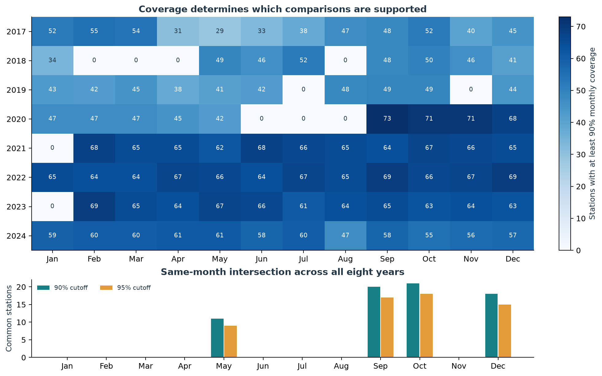
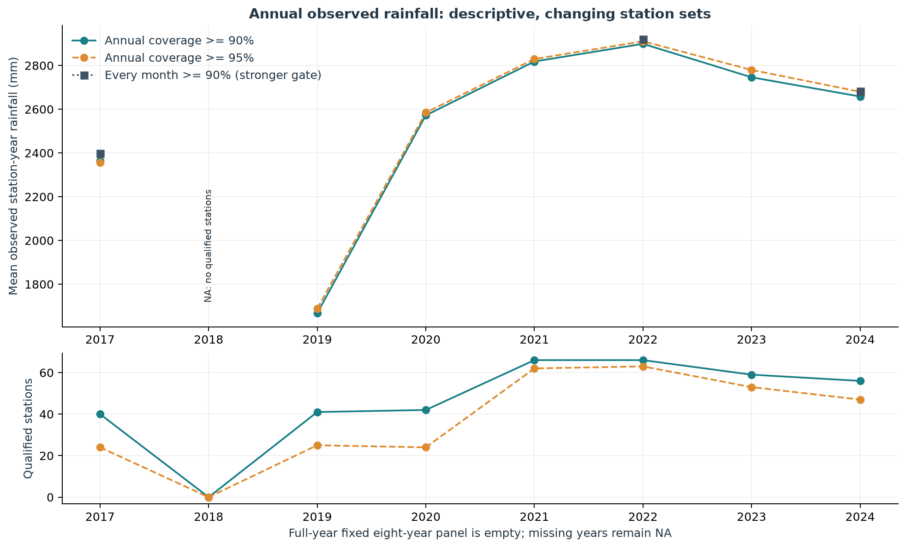
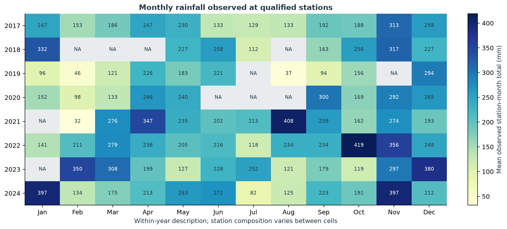
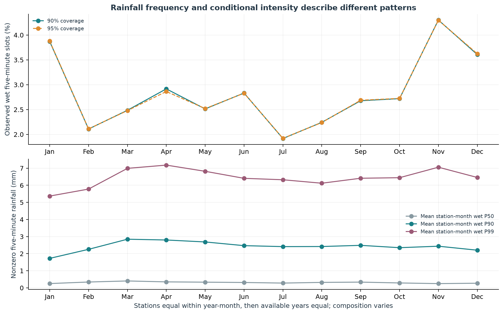
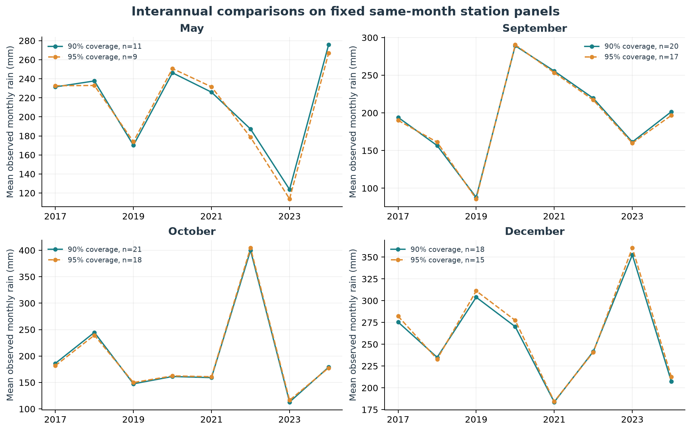
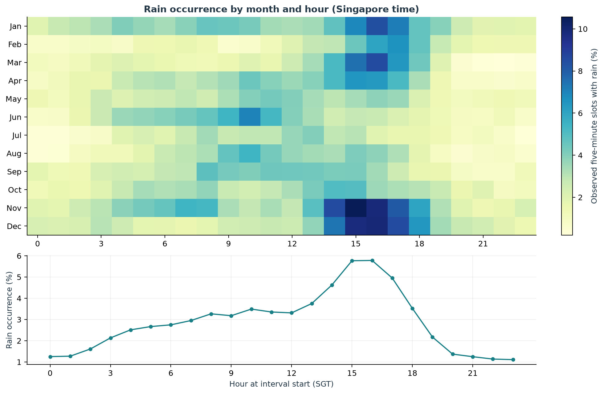
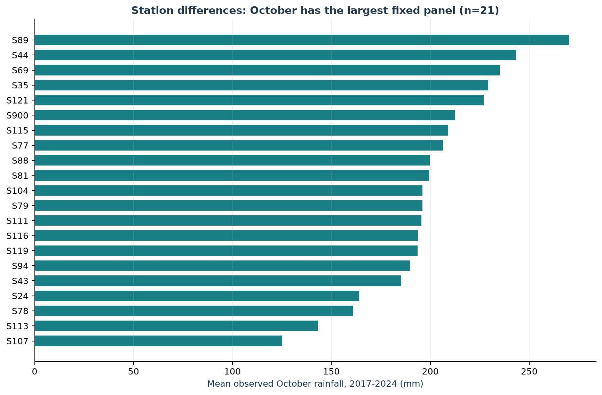

# Singapore rainfall patterns and historical features: B report

Feature version B_v2. This chapter covers Task 1 and historical inputs; completed C results are reported separately in C_delivery and the integrated submission.

## Data and analysis policy

Use 48,538,627 cleaned 2017–2024 observations. Spark performs full-data aggregates/features; Matplotlib reads small summaries. A release hashes/schema and 6,528 station-month counts/exact sums were checked. Missing rain is unknown, actual zeros and finite nonnegative extremes remain. Singapore calendar uses interval starts; station means are equally weighted and observed totals are not coverage-inflated.

# Prediction time and rainfall interval contract

## Project assumptions and evidence boundary

The frozen project selects L1/D1: an aligned slot_end_ts is the endpoint of a five-minute interval. Original event_ts remains available; only 2017 epochs with remainder 299 modulo 300 are advanced by one second. This interval meaning is a disclosed engineering assumption, not an independently verified official definition.

The anchor is t = prediction_epoch_s = slot_end_epoch_s, in Asia/Singapore. Task 1 groups by rain_period_start_ts = slot_end_ts - 300 seconds. A midnight-ending interval starts at 23:55 on the preceding date.

## Last observation available at t

Under retrospective event-time availability, R(t) over (t-5min,t] is completed and available at t. No input endpoint may exceed t. Twelve exact endpoints t-55min,...,t cover (t-60min,t]. Publication/update delay is not reconstructed as an as-of historical version. If R(t) is unavailable at real prediction time, the cutoff, features and evaluation must be redesigned; the current result is not a demonstrated live-deployment result.

## Future labels

| Slot | Endpoint | Rainfall interval |
|---|---|---|
| 1 | t+5min | (t,t+5min] |
| 2 | t+10min | (t+5min,t+10min] |
| 3 | t+15min | (t+10min,t+15min] |
| 4 | t+20min | (t+15min,t+20min] |
| 5 | t+25min | (t+20min,t+25min] |
| 6 | t+30min | (t+25min,t+30min] |

future_30m_mm = R(t+300)+...+R(t+1800), covering (t,t+30min] and excluding R(t). All six positions are required, otherwise the total is null. Decimal totals are compared strictly with threshold_mm: equality is negative; unknown is not negative.

At 2019-05-15 14:30 SGT, the latest input interval is (14:25,14:30]; the future spans (14:30,14:35] through (14:55,15:00]. Use exact timestamp positions, not the previous 12/next 6 rows, and load cross-year context.

## Implementation status

A's frozen labels and B's offline/past-only features use this endpoint/six-slot contract. Cross-year, missing-slot and all-26-feature checks pass. C's actual post-sample joins, strict labels and saved-model past-only prediction interface now also pass. This verifies implementation consistency; official timestamp meaning and real publication availability remain assumptions to review before live deployment.

## Coverage and annual descriptions

Main monthly coverage is 90%, sensitivity 95%. Eight-year same-month fixed panels support May, September, October and December only. Empty panels do not mean no rain. Annual denominators are complete calendars including leap years. Station composition changes; 2018 has no annual-90% station and remains NA. The fixed eight-year annual intersection is empty, so descriptive annual sums do not establish national trends.

Figure 1. Qualified stations and fixed same-month panels.

| Year | Annual >=90% stations | Observed annual mean/mm | Every-month >=90% stations | Stricter observed mean/mm |
| --- | --- | --- | --- | --- |
| 2017 | 40 | 2364.8700010000002 | 9 | 2397.377775555555 |
| 2018 | 0 | NA | 0 | NA |
| 2019 | 41 | 1667.9496826829268 | 0 | NA |
| 2020 | 42 | 2571.9762635714287 | 0 | NA |
| 2021 | 66 | 2818.1259457575757 | 0 | NA |
| 2022 | 66 | 2898.890046060606 | 54 | 2920.850739259259 |
| 2023 | 59 | 2745.8761364406782 | 0 | NA |
| 2024 | 56 | 2658.058855357143 | 29 | 2682.2804472413795 |

Figure 2. Annual coverage sensitivity and composition.

## Seasonal occurrence and intensity

Figure 3. Qualified-station monthly observed means; unsupported cells remain NA.

The largest descriptive cell is October 2022, 419.1 mm (66 stations); the smallest is February 2021, 32.0 mm (68 stations). Month lengths, coverage and composition differ, so these are not fixed-network rankings.

Figure 4. Wet-slot frequency and conditional nonzero intensity.

At 90% coverage the peak wet fraction is month 11: 4.30%; peak nonzero P90 is month 3: 2.84 mm per five minutes. Spark percentile_approx accuracy=1000 computes station-month nonzero quantiles before equal-weight averaging; these are not pooled national quantiles. All-dry groups have zero wet fraction but unknown conditional intensity.

## Fixed-station interannual comparison

Figure 5. Fixed same-month comparisons at 90% and 95%.

| Month | Stations 90% | Stations 95% | Lowest year 90%/95% | Highest year 90%/95% | Extrema agree | Maximum mean difference/mm |
| --- | --- | --- | --- | --- | --- | --- |
| 5 | 11 | 9 | 2023/2023 | 2024/2024 | True | 9.92 |
| 9 | 20 | 17 | 2019/2019 | 2020/2020 | True | 4.90 |
| 10 | 21 | 18 | 2023/2023 | 2022/2022 | True | 5.32 |
| 12 | 18 | 15 | 2021/2021 | 2023/2023 | True | 8.00 |

Extrema agree for the four supported months at both cutoffs, although station composition and means change. October has 21 stations at 90%; 2022 averages 399.8 mm and 2023 113.0 mm. Peak years differ by month; do not call any year universally wettest or add four months into a full year. Peak occurrence months at 90%/95% are 11/11; peak P90 months are 3/3. Maximum wet-fraction change is 0.0528 percentage points. Sensitivity is not a significance test.

## Hourly and station differences

Figure 6. Singapore-time occurrence by hour and month.

Hourly panels require every hour of a station-month to meet coverage, preserving station composition across a curve; 82 supported year-months contribute equal weight. Occurrence peaks at 16:00 (5.78%) and is lowest at 23:00 (1.11%). This observed five-minute frequency is not a future-threshold prediction probability or a causal explanation.

Figure 7. Station contrasts in the largest fixed same-month panel.

October has the largest 90% panel, 21 stations; ties choose the earlier month. S89 averages 270.3 mm and S107 125.2 mm, an October contrast rather than annual ranking. Interval-start dates have 64 entirely missing network days versus 63 event-calendar days; 2018-02-17 is the calendar-definition difference, not newly discovered zero rainfall.

## Historical features and retention

# Default numeric feature definitions (B_v2)

R(t) is rainfall over (t-5min,t] under the project L1/D1 assumption, not independently verified official semantics. Original event_ts is retained; prediction keys use aligned slot_end_epoch_s. Exact endpoints are matched by epoch seconds and missing positions are never zero-filled.

The following 26 rows follow B_feature_api.NUMERIC_FEATURES order. Station and time identify the historical series/anchor. The current C model uses 22 selected numeric features and queries threshold against its fitted CDF; the legacy classifier included threshold as an extra feature.

| Name | Definition/formula | Unit | Exact historical endpoints | Includes current slot | Missing/special values |
|---|---|---|---|---|---|
| current_5m_mm | Rainfall in the last completed five-minute interval | mm | Endpoint t; interval (t-5min,t] | yes | An observed valid current anchor is required. |
| lag_5m_mm | Rainfall at the exact endpoint t-5min | mm | Endpoint t-5min and its preceding five-minute interval | no | Null if the exact endpoint is absent; do not substitute the preceding row. |
| rain_sum_15m_mm | Sum over the complete past 15-minute interval | mm | Exact endpoints through t; interval (t-15min,t] | yes | All 3 exact endpoints are required; otherwise null, never a partial sum. |
| rain_sum_30m_mm | Sum over the complete past 30-minute interval | mm | Exact endpoints through t; interval (t-30min,t] | yes | All 6 exact endpoints are required; otherwise null, never a partial sum. |
| rain_sum_60m_mm | Sum over the complete past 60-minute interval | mm | Exact endpoints through t; interval (t-60min,t] | yes | All 12 exact endpoints are required; otherwise null, never a partial sum. |
| rain_sum_previous_15m_mm | Sum over the complete previous 15-minute interval | mm | t-25min,t-20min,t-15min; interval (t-30min,t-15min] | no | All 3 exact endpoints are required; otherwise null, never a partial sum. |
| rain_change_15m_mm | Past 15-minute sum minus the preceding 15-minute sum; not physical acceleration | mm | Two adjacent 15-minute windows through t | yes | Null if either operand is missing. |
| rain_max_60m_mm | Maximum five-minute rainfall in the complete past hour | mm | 12 exact endpoints t-55min,...,t | yes | Null unless the required exact historical slots exist; never replace missing rainfall with zero. |
| rain_std_60m_mm | Population standard deviation of the 12 past-hour rainfall values (divide by 12) | mm | 12 exact endpoints t-55min,...,t | yes | Null unless the required exact historical slots exist; never replace missing rainfall with zero. |
| wet_slots_60m | Number of positive-rainfall slots in the complete past hour, from 0 to 12 | slots | 12 exact endpoints t-55min,...,t | yes | Null unless the required exact historical slots exist; never replace missing rainfall with zero. |
| hour_sin | sin(2*pi*h/24); h is Singapore hour + minute/60, m is month 1-12 | dimensionless | Singapore calendar at prediction time t; no rainfall lookup | not applicable (time only) | Computed for a valid anchor time; independent of missing rainfall history. |
| hour_cos | cos(2*pi*h/24); h is Singapore hour + minute/60, m is month 1-12 | dimensionless | Singapore calendar at prediction time t; no rainfall lookup | not applicable (time only) | Computed for a valid anchor time; independent of missing rainfall history. |
| month_sin | sin(2*pi*(m-1)/12); h is Singapore hour + minute/60, m is month 1-12 | dimensionless | Singapore calendar at prediction time t; no rainfall lookup | not applicable (time only) | Computed for a valid anchor time; independent of missing rainfall history. |
| month_cos | cos(2*pi*(m-1)/12); h is Singapore hour + minute/60, m is month 1-12 | dimensionless | Singapore calendar at prediction time t; no rainfall lookup | not applicable (time only) | Computed for a valid anchor time; independent of missing rainfall history. |
| lag_10m_mm | Rainfall at the exact endpoint t-10min | mm | Endpoint t-10min and its preceding five-minute interval | no | Null if the exact endpoint is absent; do not substitute the preceding row. |
| lag_15m_mm | Rainfall at the exact endpoint t-15min | mm | Endpoint t-15min and its preceding five-minute interval | no | Null if the exact endpoint is absent; do not substitute the preceding row. |
| lag_30m_mm | Rainfall at the exact endpoint t-30min | mm | Endpoint t-30min and its preceding five-minute interval | no | Null if the exact endpoint is absent; do not substitute the preceding row. |
| wet_current | 1 if current_5m_mm>0, otherwise 0 | 0/1 | Endpoint t | yes | Null for a missing lag; genuine observed zero gives 0. |
| wet_lag_5m | 1 if lag_5m_mm>0, otherwise 0 | 0/1 | Exact endpoint t-5min | no | Null for a missing lag; genuine observed zero gives 0. |
| wet_lag_10m | 1 if lag_10m_mm>0, otherwise 0 | 0/1 | Exact endpoint t-10min | no | Null for a missing lag; genuine observed zero gives 0. |
| consecutive_wet_slots_60m | Trailing positive-rainfall slot count from t backwards; 0 when currently dry; capped at 12 | slots | t-55min,...,t | yes | Null for incomplete history; all 12 wet gives 12 with the left-censor flag; this does not establish continuous rain within each slot. |
| wet_run_left_censored_60m | 1 when all 12 slots are wet, indicating the wet run may have started before the observed hour; otherwise 0 | 0/1 | t-55min,...,t | yes | Null unless the required exact historical slots exist; never replace missing rainfall with zero. |
| minutes_since_last_rain_60m_capped | Minutes from t to the latest observed wet-slot endpoint; use code 60 when none is observed | minutes/censoring code | t-55min,...,t; observed ages 0,5,...,55 | yes | Null for incomplete history; complete but all dry gives unknown-gap code 60, paired with no_rain_observed_60m. |
| no_rain_observed_60m | 1 when all 12 observed slots are dry; 0 when at least one is wet | 0/1 | t-55min,...,t | yes | Null for incomplete history; 1 does not imply there has never been rainfall. |
| rain_change_5m_mm | current_5m_mm minus lag_5m_mm | mm | Exact endpoints t-5min and t | yes | Null if either operand is missing. |
| rain_ratio_15m_30m | Past 15-minute rainfall sum divided by past 30-minute sum | dimensionless, 0-1 | t-25min,...,t | yes | All 6 slots required; divide when the denominator is positive; complete all-dry gives 0; missing slots give null. |

## Audit columns outside the default model inputs

n_valid_15m/n_valid_30m/n_valid_60m/n_valid_previous_15m count valid historical positions; history_complete_60m tests all 12. The uncapped minutes_since_last_rain_60m is null when no rain is seen in the hour and is not a default model feature. Prediction timestamps/year are keys or partition fields, not wholesale numeric model inputs. Twelve wet slots do not establish the true storm start or uninterrupted within-slot rainfall. Inference requires complete history and does not use future-label validity.

| Year | Observed anchors | Complete 60m history | Incomplete | Retention |
| --- | --- | --- | --- | --- |
| 2017 | 5256020 | 4941980 | 314040 | 94.025% |
| 2018 | 4594246 | 4028323 | 565923 | 87.682% |
| 2019 | 5026862 | 4965109 | 61753 | 98.772% |
| 2020 | 6334473 | 6264593 | 69880 | 98.897% |
| 2021 | 7044646 | 6995148 | 49498 | 99.297% |
| 2022 | 7133230 | 7091648 | 41582 | 99.417% |
| 2023 | 6742890 | 6704161 | 38729 | 99.426% |
| 2024 | 6406260 | 6356871 | 49389 | 99.229% |

1,190,794 incomplete histories are retained with null window summaries, not removed or filled. Complete-history supervision excludes them without rewriting valid future truth. History/future exclusions overlap; this table is not final model sample retention. Overall complete history is 97.547%; 2018 is notably lower. Results apply to the supported complete-history scope.

## Join checks and C handoff

Measured base-table join totals:

| Metric | Value |
| --- | --- |
| left_rows | 48538627 |
| right_rows | 48538627 |
| left_unique_keys | 48538627 |
| right_unique_keys | 48538627 |
| left_duplicate_key_groups | 0 |
| right_duplicate_key_groups | 0 |
| left_duplicate_excess_rows | 0 |
| right_duplicate_excess_rows | 0 |
| left_null_key_rows | 0 |
| right_null_key_rows | 0 |
| left_unmatched_rows | 0 |
| right_unmatched_rows | 0 |
| inner_join_rows | 48538627 |
| left_join_rows | 48538627 |
| row_inflation | 0 |
| left_match_rate | 1.0 |
| right_match_rate | 1.0 |
| status | PASS |

Keys are station_id+prediction_epoch_s. Audit C actual role-filtered/sampled anchors before threshold expansion, not only full base tables. Require unique/null-free keys, every left match and no inflation; unused right rows are allowed. Expanded keys add threshold_mm and must have the supported threshold count per anchor. Never hide duplicate failures with dropDuplicates. Completed C audits are recorded separately.

## Environment, timing and evidence limits

| Item | Configuration |
| --- | --- |
| Machine | MacBook Air / Apple M5 |
| Physical memory | 24 GB |
| OS | macOS-26.6.2-arm64-arm-64bit |
| Logical CPUs | 10 |
| Spark | local[2], 4g heap, 128 shuffle partitions, 32 MiB reads, AQE on/coalescing off |
| Full observation caching | Disabled |
| Peak memory | Not measured |

Task 1 aggregation elapsed 32.3 seconds: release verification/startup through aggregate CSV writing, excluding later metadata hashes, figures/report and shutdown. Feature elapsed 142.8 seconds: verification, reads, computation, annual writes/readback and first probes through validation, excluding later metadata hashes/shutdown/plots/report and later independent 513-probe/API checks. Original v2 reused aggregates; the 2026-10-12 rerun recomputed them. Join auditing has separate timing. Single-run measurements did not control OS file cache and are not benchmarks.

B_v2 validation: 48,538,627 rows, 47,347,833 complete histories, annual A agreement and complete-history 26-column nonnull checks. Fixed seed 20261011 selected 20 stations x20 anchors plus 113 real boundary anchors: 513 independent timestamp-dictionary probes. Six synthetic wet/dry/missing/cross-year cases and five join cases passed. Stored validation JSON defines exact check scope.

## Limitations and AI use

Interval/event-time availability assumptions and actual publication delay remain unverified. Changing composition, missingness, approximate quantiles and complete-history eligibility limit interpretation. No causal control or significance test establishes physical attribution. Current C controlled feature ablation provides model-conditional predictive comparisons, using training-only transformations and E2 development validation. The known 2024 test belongs only to the original C_v1 model. OpenAI Codex assisted design, code, execution, checks, figures and drafting; actual counts come from saved outputs, and automated checks do not replace member review. Final submission requirements and completed group results are documented in submission.

## Integrated Task 1 additions and current modelling handoff

The current main report in submission/Final_Report_EN.md integrates all nine task1_v2 figures. Adjacent-year analysis fixes all seven year pairs and 12 months and compares identical stations meeting 90% coverage within each cell. Of 84 cells, 63 are supported (35 outside the four fixed eight-year months); the largest October increase is +255.27 mm in 2021–2022 (63 stations), and decrease -301.58 mm in 2022–2023 (59 stations). Local station sets change, so these differences cannot form a national trend or annual total.

The map uses the same 21-station October panel and latest recorded coordinates. S113 recorded positions differ by approximately 39 metres, of unknown cause; there is no spatial interpolation. November/afternoon occurrence patterns are compatible with the climate background described by MSS (https://www.weather.gov.sg/climate-climate-of-singapore/), without proving a physical mechanism or matching official rain-day definitions.

Current C selects cdf_persistence_d8_leaf1000 using 22 recent/persistence features, development Brier 0.01679503 after the leaf250/500/1000 comparison. Calendar/station additions did not improve the separate controlled feature ablation, which remains a fixed-leaf500 experiment. Continuous threshold support, strong baselines, month/station/history diagnostics and development-only limitations are documented in C_delivery and the main report. Original 2024 scores are preserved and have not been reassigned to the current model.
