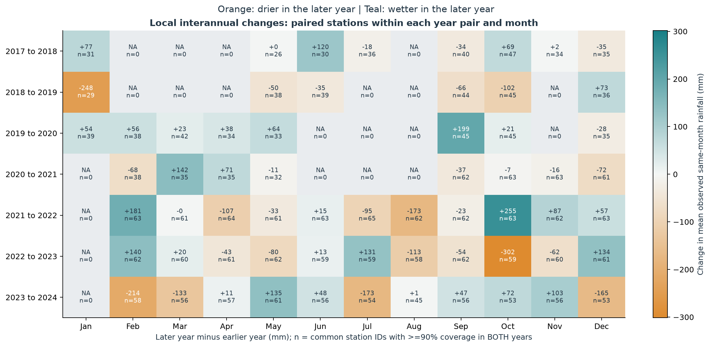
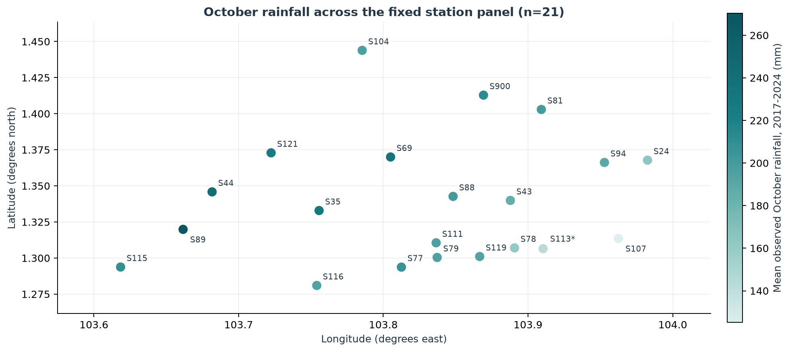

# 新加坡降雨规律分析与历史特征构建：B部分中文报告

版本：2026-10-13 Task 1逻辑重排与图表样式统一；数值特征版本仍为 B_v2。本文可直接复制、修改并合并进组报告。

**报告范围**：B负责Task 1及供C使用的历史特征，本文不重复C模型训练及预测评价。合并后的仓库已包含C成果及全组英文提交材料，见C_delivery与submission；本稿是更新后的B中文章节。

## 1. 数据处理与分析口径

使用2017—2024年正式发布的 48,538,627 条清洗观测。Spark完成原始规模的统计与特征处理，Matplotlib只读取小型汇总表作图。B读取A冻结发布并校验文件哈希和schema；月度观测数量与Decimal雨量累计已对照A的区间日历覆盖表，核对6,528个站点—月份条目。缺测始终表示未知，真实零雨量保留为零，不任意填补或截断有效极端值。完整清洗方法由A在最终报告说明。

Task 1采用Asia/Singapore时区的区间起点归属年月和小时。基本有雨指标为五分钟雨量>0；月累计为实际观测累计，不按覆盖率补齐。站点在同一格内等权，跨年描述图再对可用年份等权。

## 2. 预测时间、观测可用性与标签区间

### 1. 项目当前约定与证据边界

A 的冻结 `configs/project.json` 选择 L1/D1：雨量解释为截至对齐后 `slot_end_ts` 的五分钟区间量。`event_ts` 是保留的原始解析时间；仅2017年且 epoch 秒除300余299的记录向后对齐1秒，其余不变。原始时间和对齐标记仍可追溯。该区间解释是项目明确假设，不应写成已由官方文档独立证明。

预测时刻 `t = prediction_epoch_s = slot_end_epoch_s`，时区 Asia/Singapore。Task 1 按 `rain_period_start_ts = slot_end_ts − 300秒` 归属年月日与小时。例如末端00:00的五分钟雨量归前一天23:55起始区间。

### 2. t 时刻可用的最后一条观测

回溯事件时间假设下，末端为 t、对应区间 `(t−5min,t]` 的观测 R(t) 已完成且可用，可作为当前槽输入；所有输入末端不得大于 t。最近60分钟使用12个精确末端 `t−55min,…,t−5min,t`，对应区间并集 `(t−60min,t]`。

这一假设不等于真实在线可用性已经验证：数据可能有发布或更新延迟，当前方案没有按 `update_ts/reading_update_ts` 重建 as-of 数据版本。若真实时刻t尚未获得R(t)，必须重新定义可用观测截止点并同步特征与评价；不能直接宣称当前结果是实时部署表现。

### 3. 未来30分钟标签：只包含下面六个区间

| 槽 | 末端 | 雨量区间 |
|---|---|---|
| 1 | t+5min | (t,t+5min] |
| 2 | t+10min | (t+5min,t+10min] |
| 3 | t+15min | (t+10min,t+15min] |
| 4 | t+20min | (t+15min,t+20min] |
| 5 | t+25min | (t+20min,t+25min] |
| 6 | t+30min | (t+25min,t+30min] |

`future_30m_mm = R(t+300)+R(t+600)+…+R(t+1800)`，区间并集为 `(t,t+30min]`，**不包含当前 R(t)**。六槽全部有效才有累计量，否则 null。阈值标签为 `future_30m_mm > threshold_mm`；相等为负例，未知不能当负例。累计及严格阈值比较沿用A的Decimal语义。

例如 t=2019-05-15 14:30 SGT：最后可用观测对应(14:25,14:30]；标签依次对应(14:30,14:35]至(14:55,15:00]。历史和未来用精确时间位置，不能使用“前12行/后6行”替代；跨年必须读取必要上下文。

### 4. 实现与证据状态（2026-10-13合并后）

A冻结标签、B历史特征及C预测入口采用末端/六槽约定。仓库已包含C的fold1/2/3与final实际输入关联记录、严格标签测试及模型重载核验；保存的记录报告PASS。此处读取已有证据，没有重跑训练或最终测试；官方时间语义与真实发布延迟仍不是已证实的事实。

证据目录：C_delivery/results/C_v1_20261012。三方成员仍需人工复核提交版本和实际可用性假设。

## 3. Task 1：数据覆盖与比较范围

覆盖门槛决定哪些比较成立。主分析采用月覆盖率≥90%，另以≥95%做敏感性分析。严格八年同月共同站点仅支持5、9、10、12月；其他月份空交集不表示没有降雨。

图1：各年各月合格站点数，以及八年同月共同站点数量。

下面先讨论年内的月份、降雨频率与小时规律，再讨论跨年变化，最后比较同一面板内的站点差异。

## 4. Task 1：年内降雨规律

### 4.1 月度观测雨量概览

图2：各年各月合格站点的平均观测累计雨量，NA为无合格站点。

描述性格子中，2022年10月最高，为419.1 mm（66站）；2021年2月最低，为32.0 mm（68站）。这同时受天气、观测覆盖及站点组成影响，不是固定站网跨年排名；各月天数也不同。

### 4.2 降雨频率与条件强度

图3：有雨槽比例与条件于有雨的五分钟雨量P50/P90/P99。

90%门槛下，描述性有雨槽比例最高为11月（4.30%）；平均非零P90最高为3月（2.84 mm/五分钟）。发生频率和条件强度是不同指标，月累计还受月份时长影响。

分位数使用Spark percentile_approx（accuracy=1000），先计算站点—月份的非零分位数，再对合格站点及可用年份等权平均；**不是全国汇集观测的分位数**。全干站点—月份频率为0，但条件强度分位数未知，不补成0。来源表保留强度指标各自的支持数量。

### 4.3 一天中的降雨发生规律

图4：新加坡时间下月×小时有雨比例，以及全天剖面。

小时比较要求一个站点—月份全部24小时各自均≥90%覆盖，以相同站点构成比较一天各小时。先对站点等权，再对82个受支持年—月等权。峰值在16时，为5.78%；最低在23时，为1.11%。这些是已记录五分钟槽的有雨比例，不是未来30分钟超阈值概率，也不能证明物理因果机制。

### 4.4 天气背景与结果解释

本项目的描述结果中，11月有雨槽比例较高，小时剖面在16时达到峰值。MSS官方气候介绍指出，新加坡通常11—1月雨量较多，下午降雨也较频繁；东北季风涌动及午后对流是相关天气背景。因此，这些观察与已知气候背景相容，有助于理解年内和日内差异，但本项目没有将个别降雨过程分类，也未控制风场、海风或其他气象变量，不能据此证明产生这些结果的物理机制。[MSS：Climate of Singapore](https://www.weather.gov.sg/climate-climate-of-singapore/)（查阅：2026-10-13）

官方长期气候资料与本项目的时间段、站点、覆盖筛选和指标定义不同；本项目的五分钟有雨槽比例也不等同于官方“雨日数”。不能将不同来源的数值直接作同口径比较，也不能把某一月份的短期异常解释成长期气候趋势。

## 5. Task 1：跨年降雨变化

### 5.1 年度概览与可比性限制

年度覆盖率分母是完整日历年五分钟槽数，正确处理闰年；先汇总单站年度实际雨量，再对该年合格站点等权。另列每个月都≥90%的更严格要求，以暴露全年覆盖率可能掩盖的集中缺测。

| 年份 | 全年覆盖≥90%站点数 | 平均观测年雨量/mm | 每月均≥90%站点数 | 强门槛平均观测年雨量/mm |
| --- | --- | --- | --- | --- |
| 2017 | 40 | 2364.9 | 9 | 2397.4 |
| 2018 | 0 | NA | 0 | NA |
| 2019 | 41 | 1667.9 | 0 | NA |
| 2020 | 42 | 2572.0 | 0 | NA |
| 2021 | 66 | 2818.1 | 0 | NA |
| 2022 | 66 | 2898.9 | 54 | 2920.9 |
| 2023 | 59 | 2745.9 | 0 | NA |
| 2024 | 56 | 2658.1 | 29 | 2682.3 |

图5：全年90%/95%覆盖门槛与每月均90%门槛下的年度描述及站点数。

2018没有站点达到全年90%覆盖，保留NA；八年固定年度面板为空。各年站点构成不同，年度观测累计并非补齐缺测后的完整年估计，也不能据此得出全国年度趋势。更严格逐月门槛还会使更多年份不受支持。

由于年度合格站点组成变化、八年固定年度面板为空，下面转向固定同月份站点的比较，以提高跨年可比性。

### 5.2 严格八年同月比较与覆盖门槛敏感性

图6：严格同月固定站点面板的2017—2024年比较，90%与95%覆盖门槛。

| 月份 | 90%站点数 | 95%站点数 | 最低年90%/95% | 最高年90%/95% | 极值年一致 | 各年两门槛均值差的最大绝对值/mm |
| --- | --- | --- | --- | --- | --- | --- |
| 5 | 11 | 9 | 2023/2023 | 2024/2024 | 是 | 9.92 |
| 9 | 20 | 17 | 2019/2019 | 2020/2020 | 是 | 4.90 |
| 10 | 21 | 18 | 2023/2023 | 2022/2022 | 是 | 5.32 |
| 12 | 18 | 15 | 2021/2021 | 2023/2023 | 是 | 8.00 |

表中差值定义为：

$$
D_m=\max_{y\in\{2017,\ldots,2024\}}\left|\bar R_{y,m}^{(90\%)}-\bar R_{y,m}^{(95\%)}\right|.
$$

其中，$\bar R_{y,m}^{(c)}$ 是覆盖门槛 $c$ 对应八年共同站点面板在年份 $y$、月份 $m$ 的平均观测累计雨量（mm）。先对**同一年、同一月份的两种门槛**求差，再取八年中最大绝对值；不是最高年份与最低年份的雨量差。十月该敏感性差值约5.32 mm，而90%面板最高年与最低年的差约286.81 mm，两者不能混用。对应CSV字段保留为`max_abs_mean_difference_mm`，以兼容已有读取代码。

英文表头建议使用：`Maximum absolute difference between 90% and 95% panel means across years (mm)`。

90%与95%门槛支持的月份相同，收紧门槛减少站点数。上表直接核对最高/最低年份，而非笼统声称结果完全相同。平均雨量的变化同时反映被排除站点的组成差异，不是同一批站点上的独立实验。

十月90%固定21站的2022年观测均值399.8 mm，2023年113.0 mm。不同月份的最高年份不一致，不能概括某一年处处最湿，也不能把仅支持的四个月相加当全年。

频率图90%/95%门槛下的最高月份分别为11/11月，非零P90最高月份分别为3/3月；12个月有雨比例均值的最大绝对差为0.0528个百分点。此敏感性反映描述口径稳定程度，不等于统计显著性检验。

### 5.3 补充：相邻年份同月份共同站点比较

保留前面的严格八年面板作为主分析，另预先固定七对相邻年份（2017—2018至2023—2024），逐月选取两年该月覆盖率均≥90%的共同站点编号。每个格子内，两年使用完全相同的站点并等权，计算后一年减前一年的平均观测累计雨量。全部84个格子均列出；没有共同站点时保留NA，不挑选有明显差异的月份。

令 $I_{y,m}$ 为年份 $y$ 与 $y+1$ 在月份 $m$ 均达到90%覆盖的共同站点集合，则：

$$
\Delta_{y,m}=\frac{1}{|I_{y,m}|}\sum_{s\in I_{y,m}}\left(R_{s,y+1,m}-R_{s,y,m}\right).
$$

$R$ 为站点该月实际观测累计雨量（mm），不是缺测补齐量。正值表示共同站点在后一年该月更湿，负值表示更干；$n=|I_{y,m}|$，不是置信度或独立天气事件数量。

图7：相邻年份同月份共同站点的平均观测雨量差（后一年−前一年，mm）；每格标注共同站点数n，雨量差显示为整数、精确值见CSV；灰色NA表示无共同站点。

| 相邻年份 | 支持月份数/12 | 各支持月份共同站点数范围 |
| --- | --- | --- |
| 2017—2018 | 8 | 26—47 |
| 2018—2019 | 6 | 29—45 |
| 2019—2020 | 8 | 33—45 |
| 2020—2021 | 8 | 32—63 |
| 2021—2022 | 11 | 61—65 |
| 2022—2023 | 11 | 58—62 |
| 2023—2024 | 11 | 45—61 |

84个局部比较中，63个有共同站点支持，其中35个来自严格八年面板不支持的其他月份。作为全部格子的描述性极值，最大增加为2021→2022年10月，平均观测雨量从163.08增至418.35 mm，差+255.27 mm（63站）；最大减少为2022→2023年10月，从419.99变为118.41 mm，差-301.58 mm（59站）。这些是遍历全部格子后的描述性最大/最小值，未作显著性或多重比较检验。

这补充了局部可比信息，但估计对象不同于固定八年面板：共同站点会随年份对和月份改变，不能把局部差值串联成全国长期趋势，也不能拼接成全年总雨量。月累计仍受残余缺测与站点坐标/测量条件影响；涉及闰年的二月还存在月份天数差异，未按天标准化。因此该图只描述局部共同站点的观测月总量变化，不用于物理归因。无需重跑原始Spark聚合；图7与表格仅读取此前已核验的站点—月份汇总。

## 6. Task 1：同一面板内的空间差异

先看站点位置，再比较雨量数值。十月拥有最大的严格90%八年同月共同站点面板，共21站，因此用于本节；同数时选较早月份。两张图使用完全相同的站点编号及雨量均值。

图8：十月共同面板的21个站点位置，颜色表示2017—2024年平均十月观测累计雨量。

图注：位置采用A元数据中最后观测时刻最晚的坐标；S113星号表示两组记录坐标约相距39米，变化原因无法确认。固定编号不保证测量条件始终一致。详细核验保留在station_coordinate_audit.csv和spatial_panel_metadata_history.csv；地图不做空间插值。

图9：与图8相同21站的平均十月观测累计雨量，按数值排序。

S89最高约270.3 mm，S107最低约125.2 mm。地图提供位置背景，柱状图便于比较大小；这些是十月共同面板的描述性差异，不能当作全年站点排名或全国空间雨量估计，也未控制地理或仪器条件的影响。

### 本节分析的共同限制

区间起点日历下有64个整网无观测日期；A原始event-date审计为63，额外日期2018-02-17源于日历定义不同。缺测日不是干日。月累计没有按覆盖率补齐，固定站点编号面板也不是经过气候均一化的站网。官方资料提示可能缺测且未经过气候资料质量控制，因此以上季节、跨年与空间差异均保持描述性定位。[data.gov.sg：Historical Rainfall across Singapore](https://data.gov.sg/collections/2279/view)（查阅：2026-10-13）

## 7. Task 2：B提供的26个历史特征

令 R(t) 为末端 t 所对应五分钟区间 (t−5min,t] 的雨量。以下区间解释采用项目 L1/D1 约定；未被独立证明为官方时间语义。原始 event_ts 保留；预测键使用对齐后的 slot_end_epoch_s。所有历史精确位置以 epoch 秒匹配，缺槽不补零。

下表按 B_feature_api.NUMERIC_FEATURES 的顺序排列。station_id 是 C 编码的额外类别输入，threshold_mm 是 C 加入的额外数值输入；均不包含在这26列中。

| 名称 | 含义/公式 | 单位 | 历史范围（末端与区间） | 包含当前槽 | 缺失与特殊值处理 |
|---|---|---|---|---|---|
| current_5m_mm | 当前已完成五分钟区间的雨量 | mm | 末端 t；区间 (t−5min,t] | 是 | 仅保留有效观测锚点；当前槽缺失时不能产生该锚点 |
| lag_5m_mm | 末端为 t−5min 的单槽雨量 | mm | 精确末端 t−5min；对应其前五分钟区间 | 否 | 精确位置无有效记录则 null；不能取前一行替代 |
| rain_sum_15m_mm | 该窗口各完整五分钟区间累计雨量 | mm | t−10min,t−5min,t；区间 (t−15min,t] | 是 | 分别需要 3/6/12/3 个精确有效槽；有缺槽则 null，不作部分求和 |
| rain_sum_30m_mm | 该窗口各完整五分钟区间累计雨量 | mm | t−25min,…,t；区间 (t−30min,t] | 是 | 分别需要 3/6/12/3 个精确有效槽；有缺槽则 null，不作部分求和 |
| rain_sum_60m_mm | 该窗口各完整五分钟区间累计雨量 | mm | t−55min,…,t；区间 (t−60min,t] | 是 | 分别需要 3/6/12/3 个精确有效槽；有缺槽则 null，不作部分求和 |
| rain_sum_previous_15m_mm | 该窗口各完整五分钟区间累计雨量 | mm | t−25min,t−20min,t−15min；区间 (t−30min,t−15min] | 否 | 分别需要 3/6/12/3 个精确有效槽；有缺槽则 null，不作部分求和 |
| rain_change_15m_mm | 最近15分钟累计减前一段15分钟累计；表示两段变化，非物理加速度 | mm | t−25min,…,t；两段相邻15分钟窗口 | 是 | 任一累计为 null 则 null |
| rain_max_60m_mm | 最近60分钟单槽最大雨量 | mm | t−55min,…,t；12个精确末端 | 是 | 全部12槽有效才计算，否则 null |
| rain_std_60m_mm | 最近60分钟12个槽雨量的总体标准差（除以12） | mm | t−55min,…,t；12个精确末端 | 是 | 全部12槽有效才计算，否则 null |
| wet_slots_60m | 最近60分钟雨量 >0 的槽数，0–12 | 槽 | t−55min,…,t；12个精确末端 | 是 | 全部12槽有效才计算，否则 null |
| hour_sin | sin(2πh/24)；h=新加坡时刻的小时+分钟/60，m=月份1–12 | 无量纲 | 仅预测时刻 t 的本地日历；不读取雨量 | 不适用（只用时间） | 合法锚点时间可计算；不因历史雨量缺槽而置 null |
| hour_cos | cos(2πh/24)；h=新加坡时刻的小时+分钟/60，m=月份1–12 | 无量纲 | 仅预测时刻 t 的本地日历；不读取雨量 | 不适用（只用时间） | 合法锚点时间可计算；不因历史雨量缺槽而置 null |
| month_sin | sin(2π(m−1)/12)；h=新加坡时刻的小时+分钟/60，m=月份1–12 | 无量纲 | 仅预测时刻 t 的本地日历；不读取雨量 | 不适用（只用时间） | 合法锚点时间可计算；不因历史雨量缺槽而置 null |
| month_cos | cos(2π(m−1)/12)；h=新加坡时刻的小时+分钟/60，m=月份1–12 | 无量纲 | 仅预测时刻 t 的本地日历；不读取雨量 | 不适用（只用时间） | 合法锚点时间可计算；不因历史雨量缺槽而置 null |
| lag_10m_mm | 末端为 t−10min 的单槽雨量 | mm | 精确末端 t−10min；对应其前五分钟区间 | 否 | 精确位置缺失则 null |
| lag_15m_mm | 末端为 t−15min 的单槽雨量 | mm | 精确末端 t−15min；对应其前五分钟区间 | 否 | 精确位置缺失则 null |
| lag_30m_mm | 末端为 t−30min 的单槽雨量 | mm | 精确末端 t−30min；对应其前五分钟区间 | 否 | 精确位置缺失则 null |
| wet_current | current_5m_mm >0 为1，否则0 | 0/1 | 末端 t 的当前槽 | 是 | 有效当前锚点可计算；真实零为0 |
| wet_lag_5m | lag_5m_mm >0 为1，否则0 | 0/1 | 精确末端 t−5min | 否 | lag缺失则 null，不能将缺失判为无雨 |
| wet_lag_10m | lag_10m_mm >0 为1，否则0 | 0/1 | 精确末端 t−10min | 否 | lag缺失则 null，不能将缺失判为无雨 |
| consecutive_wet_slots_60m | 从当前槽向过去数连续正雨量槽；当前干则0；最多12 | 槽 | t−55min,…,t | 是 | 12槽不完整则 null；全湿记12并配左截断标记；槽内非持续降雨证明 |
| wet_run_left_censored_60m | 全部12槽均湿为1，表示雨段起点可能在窗口之前；否则0 | 0/1 | t−55min,…,t | 是 | 12槽不完整则 null |
| minutes_since_last_rain_60m_capped | t减最近有雨槽的末端时间（分钟）；未见湿槽时编码60 | 分钟/截断编码 | t−55min,…,t；观测到的间隔为0,5,…,55 | 是 | 12槽不完整则 null；完整但全干时60仅为未知间隔编码，必须配 no_rain_observed_60m |
| no_rain_observed_60m | 12个有效槽均干为1；窗口内有湿槽为0 | 0/1 | t−55min,…,t | 是 | 12槽不完整则 null；1不代表历史上从未下雨 |
| rain_change_5m_mm | current_5m_mm − lag_5m_mm | mm | 精确末端 t−5min 和 t | 是 | lag5缺失则 null |
| rain_ratio_15m_30m | 最近15分钟累计 / 最近30分钟累计 | 无量纲，0–1 | t−25min,…,t | 是 | 完整6槽且分母>0才相除；完整且分母0则置0（非负雨量故分子也0）；有缺槽则 null |

## 非默认模型输入的审计字段

- `n_valid_15m/n_valid_30m/n_valid_60m/n_valid_previous_15m`：有效槽数；`history_complete_60m`：12槽是否齐全。
- `minutes_since_last_rain_60m`：未截断编码的原始降雨距今时间，窗口内无湿槽时为 null；默认26列不包含它。
- `prediction_epoch_s/prediction_ts/year`：主键、日历、分区字段，不可整表直接作为模型数值输入。
- 连续湿槽数量乘5可描述已观测的连续湿槽覆盖分钟数，但不能断言槽内每秒都下雨；全湿时只能说明观察窗口内连续湿，不能推断雨段真实起点。
- 完整历史模型的推理入口要求12槽完整。此规则只看过去；不能用未来标签是否有效决定是否允许事前预测。

单锚点预测入口features_at仅接收该站点t及以前60分钟观测，要求当前锚点和12个精确历史槽完整；已与离线26列逐一核对，不提供未来行仍能复现，并拒绝缺槽或不在五分钟网格的时刻。station编码、标准化或插补必须由C在各轮训练集拟合；阈值也是C的模型输入。

## 8. 完整历史筛选的逐年影响

| 年份 | 观测锚点数 | 完整60分钟历史 | 不完整历史 | 历史保留率 |
| --- | --- | --- | --- | --- |
| 2017 | 5,256,020 | 4,941,980 | 314,040 | 94.025% |
| 2018 | 4,594,246 | 4,028,323 | 565,923 | 87.682% |
| 2019 | 5,026,862 | 4,965,109 | 61,753 | 98.772% |
| 2020 | 6,334,473 | 6,264,593 | 69,880 | 98.897% |
| 2021 | 7,044,646 | 6,995,148 | 49,498 | 99.297% |
| 2022 | 7,133,230 | 7,091,648 | 41,582 | 99.417% |
| 2023 | 6,742,890 | 6,704,161 | 38,729 | 99.426% |
| 2024 | 6,406,260 | 6,356,871 | 49,389 | 99.229% |
| 合计 | 48,538,627 | 47,347,833 | 1,190,794 | 97.547% |

不完整历史共1,190,794个锚点，占2.453%。B特征文件保留所有锚点，相应完整性不足的窗口汇总为null，没有从发布特征中删除它们，也没有补零。完整历史模型的监督样本排除这些锚点；已知未来标签仍保留作审计，不能因为历史缺失而改写其真实标签。2018的保留率明显较低，因此总体97.5%不能替代逐年说明。

A的model_anchor_eligible=historical_valid且target_valid。C监督训练/评价还需按本轮role、边界、训练站点支持等规则筛选；history_complete_60m与historical_valid的逐年完整数量已经匹配。未来完整和历史完整的排除会重叠，不能简单相加损失比例，也不能把本表保留率当最终训练样本率。

这些保留率属于全部观测锚点的描述，不能证明筛选后样本代表整个天气分布；最终评价仅适用于受支持且历史完整的范围。推理缺槽时当前接口拒绝预测，未来可另行开发并独立验证缺测鲁棒模型。

## 9. 与标签及C实际输入的一对一关联核验

| 核验项 | A正式标签表与B特征表实测 |
| --- | --- |
| 两侧行数 | 48,538,627 / 48,538,627 |
| 两侧唯一主键数 | 48,538,627 / 48,538,627 |
| 两侧重复超额行 | 0 / 0 |
| 两侧空主键行 | 0 / 0 |
| 两侧未匹配行 | 0 / 0 |
| 两侧匹配率 | 100.00% / 100.00% |
| inner关联后行数 | 48,538,627 |
| left关联后行数 | 48,538,627 |
| 关联增加样本数 | 0 |

主键为station_id + prediction_epoch_s，标签按预测锚点关联，不能仅按站点或日期。全量基础表核验按年执行，并先核验主键epoch年份与分区年份一致，因此跨分区重复不会被漏掉。

**合并后证据状态：上表是A/B基础表核验；C的实际输入关联另有保存记录。** C_delivery/results/C_v1_20261012的fold1/2/3与final目录均包含actual_input_join_audit.json，状态为PASS。final记录有10,410,105个左侧唯一锚点，未匹配左侧行及关联膨胀均为0，左侧匹配率100%。这是对已有JSON的核对，本次没有重新训练或重跑该全量关联。实际输入仍应在阈值展开前核验，失败时停止，不得先dropDuplicates掩盖问题。训练子集只要求每个左侧锚点匹配，B全量右侧额外未使用行可以存在。阈值展开后同一锚点重复是预期行为，检查应改用station_id+prediction_epoch_s+threshold_mm，并核对每锚点阈值数及展开前后行数。

## 10. 计算环境与耗时定义

| 项目 | 配置/实测 |
| --- | --- |
| 运行环境 | 本地MacBook Air，Apple M5 |
| CPU | 10个逻辑CPU；Spark本次使用2个任务线程 |
| 物理内存 | 24 GB |
| 系统 | macOS-26.6.2-arm64-arm-64bit |
| Python / Spark / Java | 3.11.9 / 3.5.7 / 17 |
| Spark执行 | local[2]，单机两个任务线程 |
| JVM heap / shuffle | 4g / 128分区 |
| 读取分区上限 | 32 MiB |
| AQE | 启用；禁用分区合并 |
| 完整输入规模 | 48,538,627条锚点（2017—2024） |
| 特征Parquet大小 | 646,490,437字节 |
| 全量内存缓存 | 未启用 |
| 峰值内存 | 没有测量，不给出数值 |

硬件清单由system_profiler在2026-10-11补查，仅保留CPU/内存等公开配置，不保存设备序列号等标识；这是同一主机的后补配置记录，不是原运行时的峰值资源测量。

原Task 1聚合源运行耗时32.3秒：计时从main中time.monotonic、发布完整性验证之前开始，到三类聚合写出完成、验证JSON写出之前结束。包括发布校验、Spark启动、实际读入/聚合、汇总CSV写出；不包括后续元数据哈希、绘图、报告或Spark关闭。v2重用了这些已验证聚合表，没有再次测量Task 1全流程时间。

v2全量历史特征运行耗时142.8秒：从发布验证前开始，到逐年Parquet生成、回读数量与空值检查、首次独立探针及schema/验证文件写出完成后、metadata调用前结束。包括实际读取、计算、写出和当次校验，不包括metadata输出哈希、Spark关闭、绘图、报告，以及之后单独补跑的513探针和预测接口核验。所有时间是单次本机观测，不是稳定性能基准，也没有清理或控制操作系统文件缓存。

全量关联核验的独立耗时见results/join_audit/validation.json；不合并计入上述旧运行时间。若修改窗口或工程配置，需使用新输出目录重新计时，不能沿用旧数字。

## 11. 验证、局限与后续工作

B_v2共48,538,627条特征，47,347,833条完整历史。逐年数量与A核对，全部窗口空值语义及完整历史26列非空检查通过。固定种子20261011抽取20个至少有20条观测的站点，每站20个锚点，结合113个实际存在的固定边界锚点，共513个独立时间戳字典核验；另有六个合成湿/干、缺槽、跨年案例。关联函数另有重复左右键、缺匹配、空键和正常匹配五个案例检查。

限制包括：项目区间与回溯可用性假设、发布延迟尚未验证、站点组成变化、缺测、近似条件分位数、仅完整历史模型的适用范围，以及没有气象因果控制或显著性检验。新增持续性特征是候选，不能在没有C验证指标时宣称提升了预测性能。

C已提交上述三轮时间验证、锁定后重拟合、2024最终评价和模型重载材料，见C_delivery及submission；本次合并保留其保存结果，不重新评价或挑选模型。后续任何模型改进仍必须遵守训练期拟合与测试集使用边界。B的Task 1描述2024不表示允许用2024标签挑选特征或模型。本文没有虚构模型分数。

## 12. AI使用声明

OpenAI Codex协助B进行分析设计、Spark特征与关联核验代码、图表、说明和报告中文草稿。数量与结论来自实际运行及保存证据，自动检查不等于人工逐行审阅。组员须理解假设与特征定义、核对结果，并据实际使用合并全组AI声明。最终提交仍需全组完整源代码与运行README、训练模型、列出成员姓名学号的最终PDF；本文为B部分可编辑材料。
