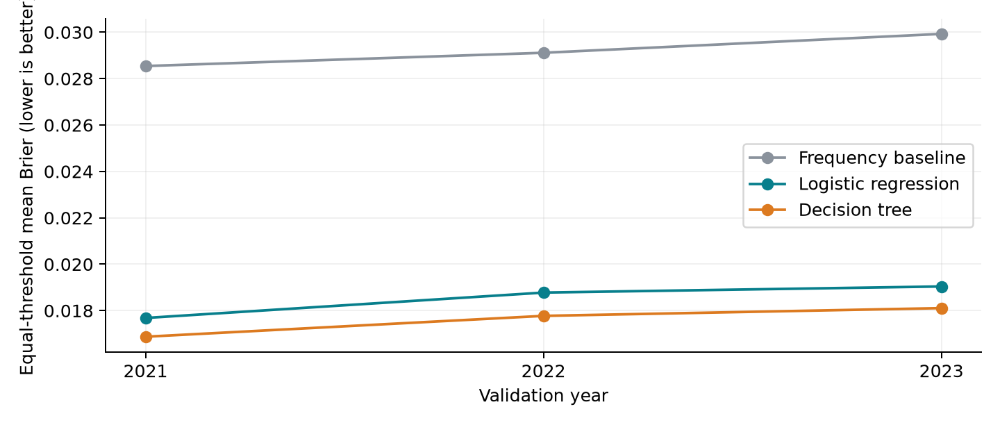
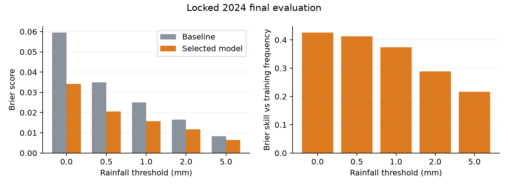
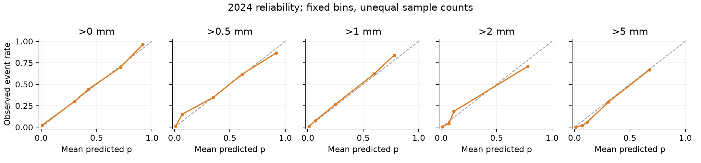

# Next-30-minute rainfall exceedance probability: C report

Experiment C_v1_20261012; B_v2 features; data v1/rainfall_v1_r3. This is a C chapter; the integrated report and member details are in submission.

## Results

Prespecified equal-threshold/equal-year Brier selected Decision tree: development mean 0.017585. After selection, refit on a fixed 10% 2017–2023 anchor sample and evaluate all supported 2024 anchors once: mean Brier 0.017736, training-frequency baseline 0.028883, skill 38.59%. Positive skill means improvement, within the documented data/eligibility scope.

## Truth, time and supported inputs

Predict P(next-30-minute total > threshold). A uses Decimal(38,18) for the six exact endpoints t+300,...,t+1800; equality is negative, unknown future is not negative. Supervision filters the correct role, full past/future windows and actual temporal boundary, including endpoint equality to the next block start. Internal training-year crossings remain usable. Past history requires 12 exact positions t−3300,...,t. Current interval (t−5min,t] is assumed available at t; official interval meaning and publication delay remain unverified.

Use B 26 past-only numeric features, numeric threshold and training-only station one-hot coding. Future truth/completeness/eligibility/role are excluded. Inference checks only existing history, supported station, grid and threshold. Support is frozen from earliest full 2017–2020 training: at least 100 positives/negatives per candidate. Thresholds 0,0.5,1,2,5 mm all pass; arbitrary continuous-threshold generalization is not claimed.

## E2 and model selection

Expanding folds train 2017–2020/validate 2021, 2017–2021/2022 and 2017–2022/2023; lock then refit 2017–2023/test 2024. A 1% pilot checks implementation; formal training samples 10%, evaluation is full eligible scope. pmod(xxhash64(station_id,prediction_epoch_s,seed),10000), seed=20261012, samples anchors before all threshold versions. Sampling is independent of outcomes with no class reweighting. Fit station StringIndexer/OneHotEncoder and LR standardization on each training fold only.

Candidates: per-threshold training frequency; L2 LR regParam=0.01/maxIter=40/tol=1e-6; tree maxDepth=5/maxBins=32/minInstancesPerNode=100 expanded rows. Average Brier equally over thresholds, then years. Tie tolerance 1e-5 prioritizes baseline, LR, tree; choices were fixed before formal scores. This limited candidate set is not exhaustive tuning.

| Model | 2021 | 2022 | 2023 | Mean | Year range |
|---|---|---|---|---|---|
| Frequency baseline | 0.028542 | 0.029113 | 0.029928 | 0.029194 | 0.001386 |
| Logistic regression | 0.017683 | 0.018778 | 0.019041 | 0.018501 | 0.001359 |
| Decision tree | 0.016875 | 0.017773 | 0.018108 | 0.017585 | 0.001233 |

selection.json was persisted before 2024 scoring; test metrics did not guide selection.

## Actual input joins and scoring coverage

Each role/eligibility/station-filtered and training-sampled anchor set is audited before threshold expansion with B_join_audit.audit_anchor_join. Require unique/null-free keys, every left anchor matched and no row inflation; unused right-side features are allowed. All checks passed. Expanded station/epoch/threshold keys are unique, each anchor has five nonnull labels. Eligibility and role never enter model inputs.

| Stage | Train anchors | Observed eval anchors | Eligible role anchors | Unknown-station exclusion | Scored anchors | Observed coverage |
|---|---|---|---|---|---|---|
| fold1 | 1,995,803 | 7,044,646 | 6,976,044 | 0 | 6,976,044 | 99.026% |
| fold2 | 2,693,419 | 7,133,230 | 7,072,758 | 0 | 7,072,758 | 99.152% |
| fold3 | 3,401,643 | 6,742,890 | 6,686,625 | 0 | 6,686,625 | 99.166% |
| final | 4,071,679 | 6,406,260 | 6,338,426 | 0 | 6,338,426 | 98.941% |

Coverage denominator is observed evaluation anchors, not an ideal complete station calendar. History/future exclusions overlap. Separate coverage.json retains individual history/joint/boundary counts. The deployed model rejects new stations.

## Locked 2024 final evaluation

| Threshold/mm | n | Positive rate | Baseline Brier | Selected Brier | Skill | Log loss | PR-AUC | ROC-AUC |
|---|---|---|---|---|---|---|---|---|
| 0 | 6,338,426 | 6.361% | 0.059571 | 0.034183 | 42.62% | 0.150547 | 0.681425 | 0.805980 |
| 0.5 | 6,338,426 | 3.627% | 0.034960 | 0.020544 | 41.24% | 0.090920 | 0.610258 | 0.839476 |
| 1 | 6,338,426 | 2.571% | 0.025050 | 0.015685 | 37.38% | 0.070748 | 0.550593 | 0.839012 |
| 2 | 6,338,426 | 1.684% | 0.016555 | 0.011781 | 28.83% | 0.055588 | 0.438596 | 0.831617 |
| 5 | 6,338,426 | 0.835% | 0.008279 | 0.006486 | 21.66% | 0.036065 | 0.357150 | 0.831203 |

Overall Brier gives equal weight to five threshold scores; skill=1−model Brier/baseline Brier. Baseline is refit on the same final sampled training. Spark BinaryClassificationEvaluator uses numBins=1000 for approximate AUC; single-class groups are NA. Log loss clips only for numerical stability to [1e-15,1−1e-15]; saved raw probabilities are unchanged.

## Reliability and limitations

Bins were fixed in advance and have unequal support; counts are in final/decision_tree_calibration.csv. No test calibration was applied. Adjacent-threshold probability increases in the test: 0 pairs. Raw predictions were not corrected for monotonicity; future inputs are not guaranteed monotone. Rare higher thresholds require support-aware interpretation rather than comparing raw Brier alone.

Station/weather composition changes, missing data and overlapping windows limit generalization. No independent-sample confidence intervals were computed. Only 10% training anchors and few candidates were evaluated, without full-training comparisons, feature ablation or external weather/radar inputs. Reject incomplete history/unknown stations. Three development years and one test year do not establish climate trends or live-deployment performance.

## Model persistence and prediction

The complete PipelineModel and prediction_contract.json in trained_model/ preserve station encoding. A fresh Spark process compared 100 test anchors/500 probabilities: maximum absolute reload error 0.000000. Past-only single-anchor predictions matched offline results at all five thresholds. Unknown station, unsupported threshold, missing history and off-grid time were correctly rejected. C_predict.RainfallPredictor.predict accepts observations, station, endpoint epoch and threshold; output includes those identifiers and probability. No future label is required to accept a request.

Training impurity importance is diagnostic, not causal or independent ablation evidence. Full weights/tree rules are in final/.

| Feature | Normalized impurity importance |
|---|---|
| rain_sum_15m_mm | 0.616424 |
| threshold_mm | 0.212747 |
| current_5m_mm | 0.108971 |
| rain_sum_30m_mm | 0.048103 |
| minutes_since_last_rain_60m_capped | 0.006784 |
| consecutive_wet_slots_60m | 0.004353 |
| rain_change_15m_mm | 0.002619 |

## Computing environment and timing

| Item | Measured/configured |
|---|---|
| Machine | Apple M3 Max |
| Physical memory | 36 GB |
| OS | macOS-14.1-arm64-arm-64bit |
| Python/Spark/Java | 3.11.17 / 3.5.7 / 17.0.20.1 |
| Spark | local[2], 6g heap, 128 shuffle partitions, 32 MiB reads, AQE on/coalescing off |
| Storage | Stage anchor/prediction Parquet, DISK_ONLY projected training vectors, no full observation cache |
| Peak memory | Not measured |

| Stage | Seconds |
|---|---|
| fold1 | 346.4 |
| fold2 | 383.9 |
| fold3 | 412.3 |
| final | 312.1 |

Stage elapsed includes actual joins, writes, expansion checks, preprocessing, fitting, full scoring and metrics/diagnostics. Excludes prior input hash verification, Spark startup, figures/report and later packaging/reload. Candidate fit_seconds measures classifier fit only, excluding shared preprocessing and frequency estimation. Single local measurements do not control OS file cache and are not stable benchmarks.

## AI use and submission scope

OpenAI Codex assisted protocol implementation, code, execution, verification, figures and English drafting. Scores are actual saved Spark results; automated checks do not replace group understanding/review. The integrated submission contains A/B/C chapters and member identities; Canvas upload remains a user action. References: Spark 3.5.7 classification/regression and ML Pipelines documentation; archive/history_v1/docs/E2_ROLLING_VALIDATION.md.

<!-- PAGEBREAK -->

## Appendix: 2021 complete development metrics

| Model | Threshold | n | Positive rate | Brier | Log loss | PR-AUC | ROC-AUC |
|---|---|---|---|---|---|---|---|
| Frequency baseline | 0 | 6976044 | 0.060931 | 0.057228 | 0.229608 | 0.060931 | 0.500000 |
| Frequency baseline | 0.5 | 6976044 | 0.035763 | 0.034500 | 0.154486 | 0.035763 | 0.500000 |
| Frequency baseline | 1 | 6976044 | 0.025885 | 0.025233 | 0.120534 | 0.025885 | 0.500000 |
| Frequency baseline | 2 | 6976044 | 0.017239 | 0.016950 | 0.087364 | 0.017239 | 0.500000 |
| Frequency baseline | 5 | 6976044 | 0.008877 | 0.008800 | 0.050912 | 0.008877 | 0.500000 |
| Logistic regression | 0 | 6976044 | 0.060931 | 0.034720 | 0.139207 | 0.669028 | 0.875574 |
| Logistic regression | 0.5 | 6976044 | 0.035763 | 0.019294 | 0.083506 | 0.640883 | 0.894947 |
| Logistic regression | 1 | 6976044 | 0.025885 | 0.015335 | 0.068513 | 0.585358 | 0.890219 |
| Logistic regression | 2 | 6976044 | 0.017239 | 0.012055 | 0.054929 | 0.507219 | 0.881205 |
| Logistic regression | 5 | 6976044 | 0.008877 | 0.007010 | 0.034073 | 0.405241 | 0.878675 |
| Decision tree | 0 | 6976044 | 0.060931 | 0.031502 | 0.141514 | 0.703433 | 0.807009 |
| Decision tree | 0.5 | 6976044 | 0.035763 | 0.019297 | 0.086308 | 0.639686 | 0.843876 |
| Decision tree | 1 | 6976044 | 0.025885 | 0.015246 | 0.069204 | 0.581411 | 0.841533 |
| Decision tree | 2 | 6976044 | 0.017239 | 0.011711 | 0.055536 | 0.468497 | 0.830913 |
| Decision tree | 5 | 6976044 | 0.008877 | 0.006618 | 0.036499 | 0.403634 | 0.828123 |

<!-- PAGEBREAK -->

## Appendix: 2022 complete development metrics

| Model | Threshold | n | Positive rate | Brier | Log loss | PR-AUC | ROC-AUC |
|---|---|---|---|---|---|---|---|
| Frequency baseline | 0 | 7072758 | 0.064804 | 0.060644 | 0.240335 | 0.064804 | 0.500000 |
| Frequency baseline | 0.5 | 7072758 | 0.035889 | 0.034612 | 0.154810 | 0.035889 | 0.500000 |
| Frequency baseline | 1 | 7072758 | 0.025229 | 0.024599 | 0.117891 | 0.025229 | 0.500000 |
| Frequency baseline | 2 | 7072758 | 0.016969 | 0.016684 | 0.086115 | 0.016969 | 0.500000 |
| Frequency baseline | 5 | 7072758 | 0.009109 | 0.009028 | 0.051979 | 0.009109 | 0.500000 |
| Logistic regression | 0 | 7072758 | 0.064804 | 0.038477 | 0.153046 | 0.646019 | 0.864880 |
| Logistic regression | 0.5 | 7072758 | 0.035889 | 0.020353 | 0.087905 | 0.608708 | 0.881650 |
| Logistic regression | 1 | 7072758 | 0.025229 | 0.015746 | 0.070586 | 0.553324 | 0.876966 |
| Logistic regression | 2 | 7072758 | 0.016969 | 0.012192 | 0.056048 | 0.487333 | 0.870590 |
| Logistic regression | 5 | 7072758 | 0.009109 | 0.007120 | 0.034610 | 0.401769 | 0.874589 |
| Decision tree | 0 | 7072758 | 0.064804 | 0.034893 | 0.155426 | 0.686436 | 0.798052 |
| Decision tree | 0.5 | 7072758 | 0.035889 | 0.020272 | 0.090266 | 0.613800 | 0.834824 |
| Decision tree | 1 | 7072758 | 0.025229 | 0.015371 | 0.070209 | 0.545945 | 0.832217 |
| Decision tree | 2 | 7072758 | 0.016969 | 0.011511 | 0.055234 | 0.437537 | 0.825002 |
| Decision tree | 5 | 7072758 | 0.009109 | 0.006821 | 0.037170 | 0.397890 | 0.831761 |

<!-- PAGEBREAK -->

## Appendix: 2023 complete development metrics

| Model | Threshold | n | Positive rate | Brier | Log loss | PR-AUC | ROC-AUC |
|---|---|---|---|---|---|---|---|
| Frequency baseline | 0 | 6686625 | 0.066713 | 0.062310 | 0.245457 | 0.066713 | 0.500000 |
| Frequency baseline | 0.5 | 6686625 | 0.037479 | 0.036092 | 0.160107 | 0.037479 | 0.500000 |
| Frequency baseline | 1 | 6686625 | 0.026297 | 0.025615 | 0.121837 | 0.026297 | 0.500000 |
| Frequency baseline | 2 | 6686625 | 0.017291 | 0.016996 | 0.087413 | 0.017291 | 0.500000 |
| Frequency baseline | 5 | 6686625 | 0.008702 | 0.008627 | 0.049975 | 0.008702 | 0.500000 |
| Logistic regression | 0 | 6686625 | 0.066713 | 0.038800 | 0.152242 | 0.672113 | 0.888477 |
| Logistic regression | 0.5 | 6686625 | 0.037479 | 0.020586 | 0.087468 | 0.635994 | 0.910461 |
| Logistic regression | 1 | 6686625 | 0.026297 | 0.016073 | 0.070502 | 0.571362 | 0.908028 |
| Logistic regression | 2 | 6686625 | 0.017291 | 0.012636 | 0.056382 | 0.481283 | 0.900575 |
| Logistic regression | 5 | 6686625 | 0.008702 | 0.007112 | 0.034088 | 0.384725 | 0.899031 |
| Decision tree | 0 | 6686625 | 0.066713 | 0.035137 | 0.155810 | 0.695372 | 0.803894 |
| Decision tree | 0.5 | 6686625 | 0.037479 | 0.020765 | 0.091492 | 0.625878 | 0.843163 |
| Decision tree | 1 | 6686625 | 0.026297 | 0.015974 | 0.071579 | 0.550121 | 0.841306 |
| Decision tree | 2 | 6686625 | 0.017291 | 0.011994 | 0.056455 | 0.429597 | 0.831717 |
| Decision tree | 5 | 6686625 | 0.008702 | 0.006670 | 0.036801 | 0.372486 | 0.831313 |
