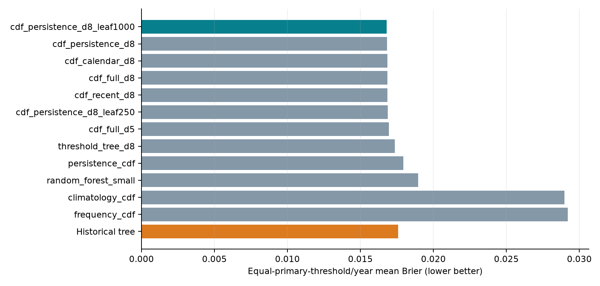
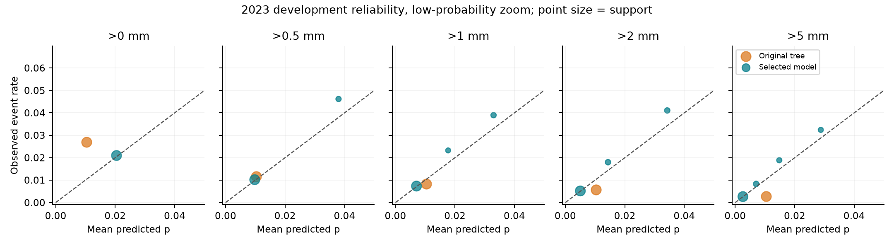
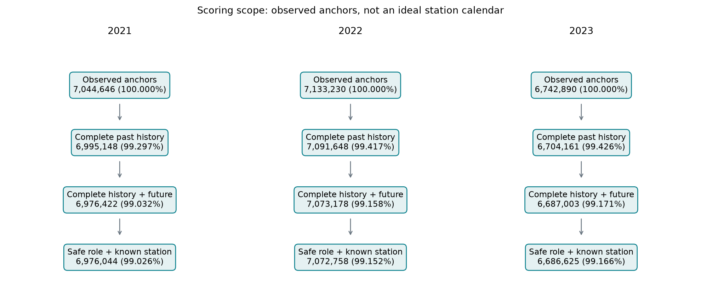
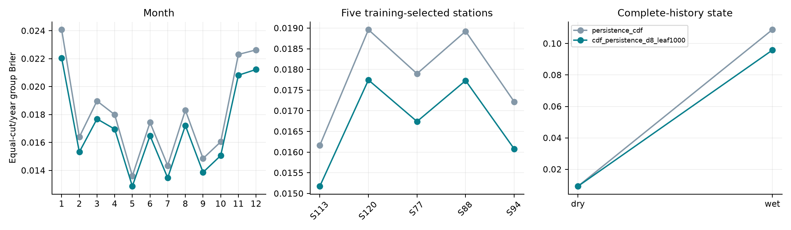

# Rainfall probabilities, stronger baselines and feature ablation

The selected conditional-distribution model is evaluated on development folds. The historical classifier and its known 2024 test are retained as separate evidence.

## Findings

Selected continuous candidate: **cdf_persistence_d8_leaf1000**, development equal-threshold/year Brier **0.016795**. Strong persistence baseline: 0.017939; climate baseline: 0.028989; global frequency: 0.029194; historical tree: 0.017585. Relative Brier reduction is 6.38% versus persistence and 42.47% versus frequency. These are probability-error reductions relative to named baselines, not accuracy improvements or superiority on every metric.

## Data, selection and test policy

Use freshly reconstructed inputs matching the original 10% fixed-hash training/full eligible validation anchors for each E2 fold. No new 2024 labels or scores are used. Original post-filter join and sample signatures are recorded; all candidates share keys. Selection uses five original cuts and equal year weights; only continuous-CDF candidates are deployment-eligible. Discrete tree/RF results are openly reported diagnostics. Held-out cuts 0.25/0.75/1.5/3 are not used to fit or select. A new 2017–2023 refit is saved after lock, but its evidence is development validation; there is no claim of a new untouched final test.

| Candidate | 2021 | 2022 | 2023 | Mean Brier | Continuous eligible |
|---|---|---|---|---|---|
| frequency_cdf | 0.028542 | 0.029113 | 0.029928 | 0.029194 | True |
| climatology_cdf | 0.028416 | 0.028968 | 0.029584 | 0.028989 | True |
| persistence_cdf | 0.017216 | 0.018134 | 0.018467 | 0.017939 | True |
| cdf_recent_d8 | 0.016166 | 0.017101 | 0.017271 | 0.016846 | True |
| cdf_persistence_d8 | 0.016121 | 0.017084 | 0.017232 | 0.016812 | True |
| cdf_calendar_d8 | 0.016202 | 0.017073 | 0.017251 | 0.016842 | True |
| cdf_full_d5 | 0.016259 | 0.017175 | 0.017448 | 0.016961 | True |
| cdf_full_d8 | 0.016202 | 0.017073 | 0.017251 | 0.016842 | True |
| cdf_persistence_d8_leaf1000 | 0.016097 | 0.017067 | 0.017221 | 0.016795 | True |
| cdf_persistence_d8_leaf250 | 0.016189 | 0.017126 | 0.017281 | 0.016865 | True |
| threshold_tree_d8 | 0.016579 | 0.017585 | 0.017895 | 0.017353 | False |
| random_forest_small | 0.018098 | 0.019147 | 0.019618 | 0.018954 | False |

| Candidate | Mean Brier | Mean log loss | Mean PR-AUC | Mean ROC-AUC |
|---|---|---|---|---|
| frequency_cdf | 0.029194 | 0.130588 | 0.030478 | 0.500000 |
| climatology_cdf | 0.028989 | 0.128169 | 0.049425 | 0.610753 |
| persistence_cdf | 0.017939 | 0.079660 | 0.544264 | 0.816221 |
| cdf_recent_d8 | 0.016846 | 0.074189 | 0.574488 | 0.846418 |
| cdf_persistence_d8 | 0.016812 | 0.074096 | 0.575936 | 0.846505 |
| cdf_calendar_d8 | 0.016842 | 0.072624 | 0.562884 | 0.894917 |
| cdf_full_d5 | 0.016961 | 0.073453 | 0.558996 | 0.885623 |
| cdf_full_d8 | 0.016842 | 0.072624 | 0.562883 | 0.894933 |
| cdf_persistence_d8_leaf1000 | 0.016795 | 0.073989 | 0.575114 | 0.846531 |
| cdf_persistence_d8_leaf250 | 0.016865 | 0.074290 | 0.574482 | 0.846500 |
| threshold_tree_d8 | 0.017353 | 0.080014 | 0.559288 | 0.828428 |
| random_forest_small | 0.018954 | 0.082222 | 0.556613 | 0.839224 |

Additional ranking/log-loss metrics are diagnostics, not replacement selection criteria. A lower Brier does not imply superiority for every cut/year/ranking measure. Complete per-cut/year metrics are retained.

## Arbitrary threshold design

Training-only conditional empirical distributions provide P(S>h)=1-F(h) for finite nonnegative Decimal(38,18) thresholds. Right-sided CDF lookup makes equality negative. For tree candidates Spark DecisionTreeRegressor fits log1p future amount using past features, then exact training amounts form leaf CDFs. Fixed prior weights are 50 anchors for leaves and 200 for baseline groups. No validation outcomes are written back into predictions. This naturally gives threshold-specific probabilities and nonincreasing stepwise survival curves without post-hoc isotonic correction; arbitrary input is not a claim of a smooth curve. Nine checked cuts lie in 0..5 mm; arbitrary input acceptance and monotonicity do not prove every threshold or extreme-tail reliability. Beyond maximum training amount, empirical probability is zero with no proven tail guarantee.

| Untrained/selection-excluded cut (mm) | Mean Brier | Mean PR-AUC | Mean log loss |
|---|---|---|---|
| 0.25 | 0.022515 | 0.680357 | 0.097211 |
| 0.75 | 0.017284 | 0.627793 | 0.076924 |
| 1.5 | 0.012813 | 0.553890 | 0.059034 |
| 3 | 0.008762 | 0.472734 | 0.042336 |

## Minimum leaf-size comparison

The supplementary development experiment freezes minInstancesPerNode at 250, 500 and 1000, holding 22 persistence features, depth 8, seed, folds, primary cuts, prior and row identities fixed. Thirty earlier candidate/fold cells are explicitly reused, and six new cells fit the two added sizes. The main rule keeps the original candidate within absolute 1e-5 of the best, then prefers 1000 over 250. This is an incremental search on already-observed development years, not an independent test. No 2024 score selects the result.

| Minimum leaf anchors | Mean Brier | Delta vs 500 | Mean PR-AUC | Mean log loss | Mean ECE |
|---|---|---|---|---|---|
| 250 | 0.016865 | 0.000053 | 0.574482 | 0.074290 | 0.002410 |
| 500 | 0.016812 | 0.000000 | 0.575936 | 0.074096 | 0.002096 |
| 1000 | 0.016795 | -0.000017 | 0.575114 | 0.073989 | 0.001819 |

Selected leaf size is 1000. Mean PR-AUC is 0.575114, versus 0.575936 for leaf500; mean fixed-bin ECE is 0.001819, versus 0.002096. The Brier-selected model need not improve every ranking metric, and the small differences are not claimed statistically significant.

## C input reconstruction acceptance

The C reconstruction script was executed from an extracted source directory using the existing formal A data and B feature Parquet. It regenerated the three development TRAIN/VALIDATION inputs and final 2017–2023 TRAIN only. Counts and two role-wise row-hash sums across all keys, targets and features match the historical anchors; these signatures are diagnostics, not cryptographic proof of row equality. Parquet bytes are expected to differ. New leaf candidates train on the rebuilt inputs; final model refit/reload and compact checks also complete. This accepts the C part of the missing-anchor workflow, not fresh-machine full A/B reproduction or Windows execution.

## Controlled feature contribution experiment

All depth-8 CDF ablations hold rows, seed, min leaf size 500, bins, prior and shared feature ordering fixed. This feature ablation precedes the separate leaf-size search. The threshold is a CDF query, not a tree input. Sequential differences test recent amount -> persistence -> periodic time -> station. Negative Brier delta means adding that group helps under this design; positive means it does not. These are model/data-conditional associations, not causal attribution. Impurity weights are separately saved but are not used as contribution evidence.

| Feature group | Mean Brier | Delta from previous | Relative reduction |
|---|---|---|---|
| Recent amount features only (14) | 0.016846 | NA | NA |
| Add wetness/persistence (22) | 0.016812 | -0.000034 | 0.001990 |
| Add cyclic time (26) | 0.016842 | 0.000030 | -0.001775 |
| Add training-only station coding (26 + station) | 0.016842 | 0.000000 | -0.000001 |

## Calibration and low-risk discrimination

The 2023 plot zooms to 0..5% and point size shows support. Complete bin counts are in each fold calibration CSV; fixed-bin ECE and low-region rates are in selected_calibration_summary.csv. The appendix gives the exact n for every point shown in the 2023 low-probability plot. Low-region membership depends on each model prediction, so its support can differ; it is not a common held-fixed subgroup comparison. Dry/wet history group tables provide that common covariate-defined comparison. No held-out calibrator is fitted.

| Cut/mm | Original ECE | Selected ECE | Selected low mean p | Selected low observed rate |
|---|---|---|---|---|
| 0 | 0.016184 | 0.002969 | 0.020037 | 0.020952 |
| 0.5 | 0.004827 | 0.001976 | 0.010161 | 0.010826 |
| 1 | 0.003437 | 0.002026 | 0.007667 | 0.008366 |
| 2 | 0.005694 | 0.001396 | 0.005958 | 0.006462 |
| 5 | 0.009469 | 0.000730 | 0.003259 | 0.003584 |

## Group performance and coverage

Groups are 12 months, five stations chosen from first-fold training counts, and complete-history all-dry/any-wet states. Exact per-year/cut rows include n, positives, Brier, mean p, fixed-bin ECE, approximate PR/ROC-AUC, eligible count and observed denominator. Group AUC uses 1,000 equal-probability histogram bins and is explicitly approximate; overall AUC uses Spark MLlib numBins=1000. No subgroup is chosen using test outcomes. Coverage is of observed anchors, not the ideal station calendar; unknown history is retained in the coverage ledger but is unscored.

| Group | Equal-cut/year Brier | Approximate PR-AUC | Mean observed coverage |
|---|---|---|---|
| history:dry | 0.009236 | 0.504682 | 0.997436 |
| history:wet | 0.095812 | 0.743110 | 0.996209 |
| month:1 | 0.022054 | 0.585831 | 0.986302 |
| month:10 | 0.015065 | 0.535515 | 0.991655 |
| month:11 | 0.020817 | 0.584223 | 0.991760 |
| month:12 | 0.021228 | 0.537458 | 0.988788 |
| month:2 | 0.015319 | 0.497674 | 0.988228 |
| month:3 | 0.017689 | 0.598573 | 0.991018 |
| month:4 | 0.016958 | 0.547426 | 0.992813 |
| month:5 | 0.012869 | 0.535460 | 0.992972 |
| month:6 | 0.016491 | 0.521667 | 0.994474 |
| month:7 | 0.013469 | 0.546301 | 0.991547 |
| month:8 | 0.017219 | 0.556388 | 0.991386 |
| month:9 | 0.013865 | 0.616486 | 0.992004 |
| station:S113 | 0.015176 | 0.547013 | 0.995828 |
| station:S120 | 0.017745 | 0.580044 | 0.995401 |
| station:S77 | 0.016741 | 0.574152 | 0.972816 |
| station:S88 | 0.017730 | 0.567055 | 0.990772 |
| station:S94 | 0.016078 | 0.561237 | 0.995448 |

## Reproduction and immutable evidence

Fresh-process model reload reconstructs 100 anchors from only past observations and compares 1,000 probabilities at ten cuts, including 3.14159 mm. Maximum error: 0.000000. Invalid station/time/history/threshold handling and monotonic examples pass. The model, report, ZIP, requirements lock and metadata stay inside this run. Finalization reads the executing Python environment via importlib.metadata, without private uv or OS-specific virtual-environment paths. All original source-run file hashes, including 2024 scores/model, pass preservation checks. Current evidence navigation identifies successful receipts without deleting historical failures.

## Computing environment and timing

Python 3.11.17, Spark 3.5.7, Java 17.0.20.1; macOS-14.1-arm64-arm-64bit; 14 logical CPUs. Each process: local[2], 6g heap, 128 shuffle partitions, 32 MiB reads. At most two fold processes overlapped. Peaks were not measured; timings are not benchmarks. Candidate timing includes fit/CDF estimation, saves, scoring and metrics; excludes shared hashes/startup, reports and packaging. Training timing includes preprocessing. Exact fold JSON and candidate_timing_summary.csv define the measured scopes.

## Remaining limitations and AI use

Development results motivated by review are now known and should not be relabelled untouched. Fixed train sampling and small candidate set limit conclusions. Overlapping windows/weather across stations are correlated; no independent-row bootstrap or significance claims are used. Observed gaps, composition changes and training leaf support affect performance. Event-time availability and official interval meaning remain assumptions; live deployment latency is unverified. OpenAI Codex assisted implementation, execution, tests, figures and drafting. All scores come from actual saved Spark outputs; member review is still required.

Official model references: [Spark DecisionTreeRegressor](https://spark.apache.org/docs/3.5.7/api/python/reference/api/pyspark.ml.regression.DecisionTreeRegressor.html) and [Spark RandomForestClassifier](https://spark.apache.org/docs/3.5.7/api/python/reference/api/pyspark.ml.classification.RandomForestClassifier.html).

<!-- PAGEBREAK -->

## Appendix: selected continuous model, 2021

| Cut/mm | n | Event rate | Brier | Log loss | PR-AUC | ROC-AUC |
|---|---|---|---|---|---|---|
| 0.0 | 6976044 | 0.060931 | 0.030033 | 0.126427 | 0.711561 | 0.842452 |
| 0.25 | 6976044 | 0.042799 | 0.021276 | 0.092676 | 0.692554 | 0.861727 |
| 0.5 | 6976044 | 0.035763 | 0.018574 | 0.082097 | 0.664752 | 0.861192 |
| 0.75 | 6976044 | 0.031126 | 0.016755 | 0.074959 | 0.641330 | 0.859055 |
| 1.0 | 6976044 | 0.025885 | 0.014719 | 0.066706 | 0.606510 | 0.855212 |
| 1.5 | 6976044 | 0.021097 | 0.012644 | 0.058253 | 0.568850 | 0.850465 |
| 2.0 | 6976044 | 0.017239 | 0.010882 | 0.051110 | 0.531067 | 0.844238 |
| 3.0 | 6976044 | 0.012973 | 0.008613 | 0.041776 | 0.484888 | 0.838400 |
| 5.0 | 6976044 | 0.008877 | 0.006276 | 0.031134 | 0.425757 | 0.840389 |

<!-- PAGEBREAK -->

## Appendix: selected continuous model, 2022

| Cut/mm | n | Event rate | Brier | Log loss | PR-AUC | ROC-AUC |
|---|---|---|---|---|---|---|
| 0.0 | 7072758 | 0.064804 | 0.033472 | 0.138865 | 0.689036 | 0.831978 |
| 0.25 | 7072758 | 0.044063 | 0.023148 | 0.099966 | 0.664498 | 0.850638 |
| 0.5 | 7072758 | 0.035889 | 0.019605 | 0.086493 | 0.635263 | 0.849580 |
| 0.75 | 7072758 | 0.030773 | 0.017315 | 0.077611 | 0.613045 | 0.847743 |
| 1.0 | 7072758 | 0.025229 | 0.014905 | 0.068068 | 0.577917 | 0.842889 |
| 1.5 | 7072758 | 0.020505 | 0.012651 | 0.059044 | 0.543579 | 0.837805 |
| 2.0 | 7072758 | 0.016969 | 0.010838 | 0.051617 | 0.514408 | 0.834181 |
| 3.0 | 7072758 | 0.013176 | 0.008821 | 0.042835 | 0.472150 | 0.832588 |
| 5.0 | 7072758 | 0.009109 | 0.006518 | 0.031972 | 0.410555 | 0.839019 |

<!-- PAGEBREAK -->

## Appendix: selected continuous model, 2023

| Cut/mm | n | Event rate | Brier | Log loss | PR-AUC | ROC-AUC |
|---|---|---|---|---|---|---|
| 0.0 | 6686625 | 0.066713 | 0.033326 | 0.137072 | 0.707493 | 0.843928 |
| 0.25 | 6686625 | 0.045559 | 0.023122 | 0.098993 | 0.684018 | 0.862187 |
| 0.5 | 6686625 | 0.037479 | 0.019862 | 0.086427 | 0.655063 | 0.862454 |
| 0.75 | 6686625 | 0.032254 | 0.017782 | 0.078203 | 0.629006 | 0.861366 |
| 1.0 | 6686625 | 0.026297 | 0.015341 | 0.068594 | 0.590120 | 0.857619 |
| 1.5 | 6686625 | 0.021309 | 0.013145 | 0.059805 | 0.549242 | 0.852919 |
| 2.0 | 6686625 | 0.017291 | 0.011247 | 0.052205 | 0.507950 | 0.847608 |
| 3.0 | 6686625 | 0.012949 | 0.008853 | 0.042399 | 0.461164 | 0.842544 |
| 5.0 | 6686625 | 0.008702 | 0.006329 | 0.031055 | 0.399262 | 0.845219 |

<!-- PAGEBREAK -->

## Appendix: exact sample count for every plotted low-probability point (2023)

| Model | Cut/mm | Bin | n | Mean p | Observed rate |
|---|---|---|---|---|---|
| Historical tree | 0 | 3 | 6,273,227 | 0.010323 | 0.026913 |
| Selected model | 0 | 4 | 6,080,591 | 0.020324 | 0.021151 |
| Historical tree | 0.5 | 3 | 6,273,227 | 0.010323 | 0.011734 |
| Selected model | 0.5 | 2 | 6,080,591 | 0.009796 | 0.010196 |
| Selected model | 0.5 | 4 | 130,423 | 0.037971 | 0.046173 |
| Historical tree | 1 | 3 | 6,273,227 | 0.010323 | 0.008240 |
| Selected model | 1 | 2 | 6,080,591 | 0.007068 | 0.007338 |
| Selected model | 1 | 3 | 81,581 | 0.017711 | 0.023253 |
| Selected model | 1 | 4 | 158,269 | 0.032974 | 0.038972 |
| Historical tree | 2 | 3 | 6,273,227 | 0.010323 | 0.005691 |
| Selected model | 2 | 2 | 6,103,843 | 0.005037 | 0.005167 |
| Selected model | 2 | 3 | 181,278 | 0.014344 | 0.017989 |
| Selected model | 2 | 4 | 172,908 | 0.034253 | 0.041062 |
| Historical tree | 5 | 3 | 6,273,227 | 0.010323 | 0.002857 |
| Selected model | 5 | 1 | 6,141,931 | 0.002593 | 0.002650 |
| Selected model | 5 | 2 | 190,584 | 0.007050 | 0.008306 |
| Selected model | 5 | 3 | 113,152 | 0.014816 | 0.018868 |
| Selected model | 5 | 4 | 95,194 | 0.028774 | 0.032408 |
